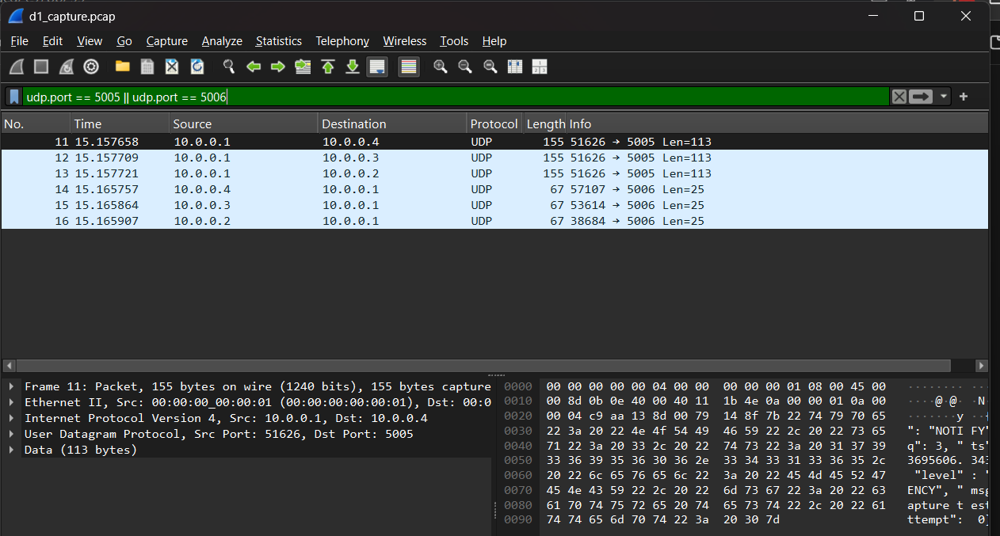

# Emergency Notification Network (UDP + SDN)

**Course:** Computer Networks (UE25CS243A), PES University
**Project:** SDN-Socket Programming Jackfruit Mini Project, Project 16

| Name | SRN |
|---|---|
| Sampann S Bhat | PES1UG25AM343 |
| Samanvitha hg | PES1UG25AM336 |
| S Prajith Kumar | PES1UG25AM323 |

## 1. Problem and objectives

Build a UDP-based emergency notification system that delivers urgent messages
to many registered clients, running inside a Mininet network controlled by an
SDN controller. The SDN must identify emergency traffic and prioritize it over
other traffic.

Objectives:
1. UDP server that accepts subscriber registrations and pushes notifications to all of them.
2. UDP clients that receive notifications, acknowledge emergencies and log latency.
3. Mininet topology controlled by a remote Ryu (OpenFlow 1.3) controller.
4. Controller that classifies emergency traffic and installs dedicated high-priority flows.
5. Application-level delivery confirmation (ACK + retransmission) for emergencies only.
6. Measurement of notification latency and packet loss under congestion (Deliverable 2).

## 2. Architecture

```
  h2, h3, h4 (subscribers)                 h1 (emergency server)
  h6 (background sink)                     h5 (background source)
          \  \  \  /                           /   /
           +-----+                           +-----+
           | s2  |========== s1-s2 link =====| s1  |
           +-----+                           +-----+
              \                                 /
               +------ OpenFlow 1.3 ----- Ryu controller (c0, 127.0.0.1:6653)
```

- **h1** runs `app/server.py`. **h2-h4** run `app/client.py`. **h5/h6** are reserved for background (congestion) traffic in D2.
- Every flow between the server and the subscribers crosses the s1-s2 link. In D2 this link becomes the bottleneck.
- Host IPs: h1=10.0.0.1 ... h6=10.0.0.6.

### Ports

| UDP port | Direction | Meaning |
|---|---|---|
| 5000 | client -> server | REGISTER / UNREGISTER |
| 5006 | client -> server | ACK (for emergency messages) |
| 5005 | server -> client | EMERGENCY notifications |
| 5010 | server -> client | ROUTINE notifications |

The controller classifies traffic by UDP destination port: 5005 and 5006 are the emergency class.

### Messages (JSON over UDP)

```json
{"type":"REGISTER","name":"h2"}
{"type":"UNREGISTER"}
{"type":"NOTIFY","seq":3,"ts":1793695606.34,"level":"EMERGENCY","msg":"capture test","attempt":0}
{"type":"ACK","seq":3}
```

### Message flow

1. Each client sends REGISTER to the server every 5 s (heartbeat), so registration survives packet loss and server restarts.
2. The operator types `e <text>` (emergency) or `r <text>` (routine) on the server.
3. The server sends one datagram per subscriber. Emergencies go to port 5005, routine to 5010.
4. For emergencies each client replies with an ACK to port 5006. The server retransmits (0.5 s timeout, up to 3 retries) only to subscribers that have not ACKed. Routine messages are fire-and-forget.
5. Clients log the one-way latency (receive time minus the server's original send time) to `results/<name>.csv`. The timestamp is fixed at first send, so latency includes any retransmission delay.

## 3. Components

| File | Role |
|---|---|
| `app/server.py` | UDP server. A listener thread (select on ports 5000 and 5006) handles REGISTER, UNREGISTER and ACK. The main thread sends notifications. A lock protects the shared registry and pending-ACK table. Malformed datagrams are ignored. |
| `app/client.py` | UDP subscriber. Heartbeat registration thread, listens on 5005 and 5010, ACKs every copy of an emergency but logs only the first copy, writes CSV. |
| `topology/topo.py` | Mininet topology: 2 OVS switches (OpenFlow 1.3), 6 hosts, RemoteController. |
| `controller/emergency_controller.py` | Ryu app. Learning switch plus emergency classification (see below). |

### Controller logic

| Priority | Match | Action | Purpose |
|---|---|---|---|
| 0 | anything | send to controller | table-miss, learn hosts |
| 10 | in_port + src/dst MAC | output | normal learned flow |
| 100 | UDP dst 5005 or 5006 | send to controller | **trap**: reports first emergency packet |
| 200 | dst MAC + UDP dst port | output | **emergency flow**, installed after classification |

The trap rule sits above the normal flows so the controller sees emergency
traffic even when ordinary flows exist for the same destination. When it fires,
the controller logs `CLASSIFIED EMERGENCY ...` and installs the priority-200
flow. Flows use a 30 s idle timeout, so classification triggers again after
quiet periods.

## 4. Setup (Windows + WSL2, Ubuntu)

```bash
sudo apt update
sudo apt install -y mininet openvswitch-switch iperf tcpdump python3-pip xterm x11-xserver-utils
sudo service openvswitch-switch start

# Ryu in its own Python 3.9 virtual environment
curl -LsSf https://astral.sh/uv/install.sh | sh
source ~/.bashrc
uv venv --python 3.9 ~/ryu-env
source ~/ryu-env/bin/activate
uv pip install "setuptools<58" wheel
uv pip install --no-build-isolation "ryu==4.34" "eventlet==0.30.2"
ryu-manager --version      # expect: ryu-manager 4.34
```

Notes:
- The app scripts use only the Python standard library.
- Mininet runs under system Python with `sudo`. Only the controller uses the venv.

## 5. How to run

Order matters. `sudo mn -c` kills any running `ryu-manager`, so run it **before** starting the controller.

**Tab 1: cleanup, then controller (venv active)**
```bash
cd ~/emergency-sdn
sudo mn -c
source ~/ryu-env/bin/activate
ryu-manager --ofp-tcp-listen-port 6653 controller/emergency_controller.py
```
Expect `switch s1 connected ...` and `switch s2 connected ...` once the network starts.

**Tab 2: network (plain tab, no venv)**
```bash
cd ~/emergency-sdn
sudo /usr/bin/python3 topology/topo.py
```
At `mininet>` run `pingall` (expect 0% dropped), then `xterm h1 h2 h3 h4`.

**In the host windows**
```bash
python3 app/server.py                      # h1
python3 app/client.py 10.0.0.1 h2          # h2
python3 app/client.py 10.0.0.1 h3          # h3
python3 app/client.py 10.0.0.1 h4          # h4
```
In the h1 window: `list`, then `e evacuate zone B`, then `r lunch at 1pm`.
Server commands: `e <text>`, `r <text>`, `list`, `quit`.

## 6. D1 test cases and results

| # | Test | Expected | Result |
|---|---|---|---|
| 1 | `pingall` through both switches | 0% dropped (30/30) | Pass |
| 2 | Clients REGISTER | h1 prints one `[+] registered` per client | Pass |
| 3 | Emergency to 3 subscribers | all clients print it, server prints `all 3 subscriber(s) ACKed` | Pass |
| 4 | Routine to 3 subscribers | all clients print it, no ACKs | Pass |
| 5 | Controller classifies emergency | `CLASSIFIED EMERGENCY notify/ack` in controller log, priority-200 flows in switch tables | Pass |
| 6 | Routine is not classified | no CLASSIFIED line for port 5010 | Pass |
| 7 | Garbage datagram sent to server | ignored, server keeps running | Pass |
| 8 | Client exits | UNREGISTER, removed from `list` | Pass |
| 9 | Missing ACKs | server retries 3 times then reports the missing subscribers | Pass (tested with `nc` as a silent subscriber) |

### Evidence

Packet capture of one emergency exchange: three NOTIFY datagrams to port 5005
and three ACKs to port 5006, with the JSON payload visible.



Switch flow tables captured right after an emergency:
[`results/flows_s1.txt`](results/flows_s1.txt) and [`results/flows_s2.txt`](results/flows_s2.txt).
They show the priority-100 trap rules, the priority-200 emergency flows
(`tp_dst=5005` per subscriber, `tp_dst=5006` toward the server), the
priority-10 learned flows and the table-miss rule.

Per-client latency logs: `results/h2.csv`, `results/h3.csv`, `results/h4.csv`.

## 7. Repository layout

```
app/          server.py, client.py
controller/   emergency_controller.py
topology/     topo.py
tests/        (experiment scripts, D2)
results/      latency CSVs, flow-table dumps
docs/         screenshots
```

## 8. Deliverable 2: dynamic SDN, congestion and evaluation

### 8.1 What was added

- **Bottleneck link.** The s1-s2 link is capped at 10 Mbit/s with Open vSwitch QoS (HTB). The s1 port facing s2 has two queues: queue 0 (default traffic) and queue 1 (emergency, higher priority). Without a bottleneck there is no congestion, and priority would have nothing to improve. Setup code: `tests/lab.py`.
- **Dynamic controller** (`controller/emergency_controller_d3.py`) with three modes, so the same test can compare approaches:
  - `baseline`: emergency flows are installed but never use the priority queue.
  - `priority`: emergency flows always use queue 1 (static).
  - `dynamic`: the controller decides at run time (below).
- **Dynamic behaviour.**
  1. *Monitoring:* every second the controller reads the byte counter of the bottleneck port and computes link utilisation.
  2. *Congestion response:* above 70% utilisation it logs `CONGESTION detected` and re-installs the emergency flows with `set_queue:1` (`PRIORITY QUEUE ON`). After utilisation stays below 30% for 3 seconds it logs `CONGESTION cleared` and returns to normal queueing.
  3. *Application signal:* when the server starts an emergency it sends `EMERGENCY_START` to the controller over a Unix socket (`/tmp/emergency_ctrl.sock`), which forces the priority queue on for 10 seconds. A Unix socket is used because Mininet hosts are in their own network namespaces and cannot reach the controller's loopback address, but they share the filesystem. This is the application-to-network integration: application events change the switches' behaviour before congestion is even measured.

### 8.2 Experiment: baseline vs static priority vs dynamic

Method: 3 subscribers, 20 emergency messages per run spaced 0.5 s apart, with a UDP flood from h5 to h6 of 15 Mbit/s ("moderate") or 50 Mbit/s ("heavy") into the 10 Mbit/s link. The first 2 messages of each run are excluded from the statistics because the first packets take a detour through the controller before flows exist. Latency is one-way (server send timestamp to client receive time). Raw data: `results/d2_dynamic.csv`.

| Load | Mode | Avg (ms) | p95 (ms) | Max (ms) | Delivered |
|---|---|---|---|---|---|
| idle | baseline | 0.37 | 0.54 | 0.65 | 100% |
| idle | dynamic | 0.41 | 0.63 | 0.78 | 100% |
| moderate | baseline | 85.86 | 107.65 | 108.88 | 100% |
| moderate | priority | 0.31 | 0.44 | 0.46 | 100% |
| moderate | dynamic | 0.36 | 0.61 | 2.00 | 100% |
| heavy | baseline | 85.69 | 108.32 | 113.73 | 100% |
| heavy | priority | 0.31 | 0.42 | 0.57 | 100% |
| heavy | dynamic | 0.32 | 0.49 | 0.62 | 100% |

Observations:
- Without prioritisation, congestion raises emergency latency from about 0.4 ms to about 86 ms.
- With the priority queue (static or dynamic), emergency latency stays at about 0.3 ms under heavy load, roughly 270 times lower than the baseline.
- Dynamic mode matches static priority while using the priority queue only when congestion is detected or an emergency is signalled. The controller log shows `CONGESTION detected: link 100% busy` followed by `PRIORITY QUEUE ON (congestion)`.
- In the idle run the queue still switched on briefly with `(app signal)`, showing the server's signal reaching the controller.
- "Moderate" (15 Mbit/s offered) already exceeds the 10 Mbit/s capacity, so it behaves like the heavy case.
- Packet loss was 0% in every run: the queue absorbs the excess and delays packets instead of dropping them, so congestion appears here as latency rather than loss.

### 8.3 Challenging scenario: heavy congestion plus a failed subscriber

`tests/scenario_failure.py` runs the dynamic controller under a 50 Mbit/s flood, freezes the subscriber on h3 (simulating a dead node), and sends 8 emergencies.

| Subscriber | Received | Avg latency | Max latency |
|---|---|---|---|
| h2 | 8/8 | 0.35 ms | 0.43 ms |
| h3 (dead) | 0/8 | n/a | n/a |
| h4 | 8/8 | 0.23 ms | 0.34 ms |

The server retransmitted to h3 three times per message and then reported `no ACK from ['10.0.0.3'] after 3 retries` for every message, naming only h3. The healthy subscribers kept receiving emergencies with sub-millisecond latency through the saturated link, and the controller switched the priority queue on at the start of the congestion.

### 8.4 Reproducing the results

Close any running Ryu, topology or demo process first (each script starts its own controller and network, and cleans up old state).

```bash
sudo /usr/bin/python3 tests/bottleneck_test.py     # proves the bottleneck exists
sudo /usr/bin/python3 tests/exp_priority.py        # idle vs flood, baseline vs priority
sudo /usr/bin/python3 tests/exp_dynamic.py         # full comparison table (about 5 min)
sudo /usr/bin/python3 tests/scenario_failure.py    # congestion + dead subscriber
sudo /usr/bin/python3 demo_app.py                  # interactive D1 demo (menu)
```

### 8.5 Limitations

- The server sends to subscribers one message at a time. A dead subscriber delays the *next* emergency's send by about 2 s (3 retries at 0.5 s). The latency metric does not show this, because the timestamp is taken when the send begins. Fixing it would need per-message sender threads or non-blocking retransmission.
- Dead subscribers are reported but not removed from the registry.
- Classification is by UDP port, so any sender using port 5005 would be treated as an emergency. A real deployment would add authentication or marking at trusted network edges.
- Utilisation thresholds (70% / 30%) and the bottleneck port are fixed in the controller configuration.
- There is one run per condition, so the table gives no confidence intervals.
- No link-failure rerouting was implemented; the topology is a tree with a single path.
